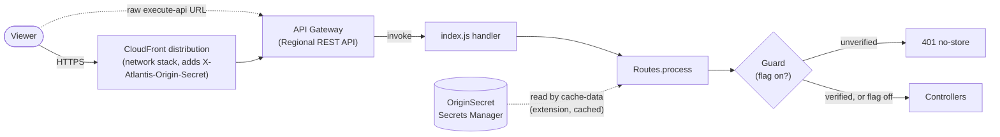

# Design: Adopt the Atlantis ingress standard

> **Requirements**: [requirements.md](requirements.md)
> **Plan**: [PLAN.md](PLAN.md) (Locked, decisions 1 to 9)

## 1. Overview

The change has four parts, all inside this application's stack:

1. `WebApi` becomes Regional in every deployment, and the function always runs with `CACHE_DATA_TRUSTED_PROXY_HOPS=0`. The client address is then `requestContext.identity.sourceIp`, which is the viewer on a Regional API.
2. An `OriginSecret` Secrets Manager secret exists in every stage.
3. When `ApiIsBehindCloudFront` is `"true"`, the function gets the secret's ARN in `CACHE_DATA_INGRESS_SECRET_NAME` and permission to read that one secret. `@63klabs/cache-data` 1.4.1 then compares the `X-Atlantis-Origin-Secret` header with the secret. A small guard in `routes/index.js` turns an unverified request into a `401`.
4. API Gateway execution data tracing is turned off when the flag is `true`, the dashboard's error log widget also shows unverified requests, and the docs describe adoption, rollback, and rotation.

All new tests and test tooling live in the spec directory. The released starter gains no test file, test dependency, or jest setting.

### 1.1 Request flow



### 1.2 What was verified while designing

A throwaway script (outside the repository) loaded the installed `@63klabs/cache-data` 1.4.1 and built a real `ClientRequest` and `Response` from a minimal API Gateway event, with no AWS call.

| Observation | Consequence for the design |
|-------------|----------------------------|
| With `CACHE_DATA_INGRESS_SECRET_NAME` set and the secret not primed, `isIngressVerified()` is `false`, `getProps().client.ingress` is `unverified`, and cache-data writes `[ERROR] The ingress secret has not been loaded...` and `[INGRESS_UNVERIFIED] {"reason":"secret-not-primed"}`. | The line format the dashboard widget parses is `[INGRESS_UNVERIFIED] {...}`, as assumed. Tests can build an unverified request with the real classes and no mocking. |
| With the variable unset, `isIngressVerified()` is `false` and `client.ingress` is `direct`. | The guard must be off when the variable is unset, as designed. |
| `reset({statusCode: 401})`, then `addHeader('Cache-Control','no-store')`, `addHeader('Expires','0')`, `setBody({...})`, then `finalize()` returns status `401`, headers `Content-Type: application/json`, `Cache-Control: no-store`, `Expires: 0`, `Access-Control-Allow-Origin: *`, `x-exec-ms`, and a JSON body. `finalize()` did not override the two headers. | The refusal builder works as designed, and a 401 is not marked cacheable. |
| A `[RESPONSE] 401 | ...` line is written for the refused request. | Returning the refusal through the normal `finalize()` path keeps the access log complete. |

## 2. Components and changes

| File (under `application-infrastructure/` unless noted) | Change | Requirements |
|---------------------------------------------------------|--------|--------------|
| `template-configuration.json` | `Parameters`: add the literal `"ApiIsBehindCloudFront": "false"` after `ApiGatewayLoggingEnabled` | 1.6 |
| `template.yml` | Parameter, group entry, two conditions, `EndpointConfiguration`, `OriginSecret`, two environment variables, one conditional IAM statement, `DataTraceEnabled`, header `Version:` | 1 to 5, 8, 12.15 |
| `template-openapi-spec.yml` | `'401'` response | 9 |
| `template-dashboard.yml` | Widget title and query | 10 |
| `src/lambda/web-service/utils/ingress-guard.js` | New module | 6 |
| `src/lambda/web-service/routes/index.js` | Call the guard first | 7 |
| `src/lambda/web-service/package.json`, `package-lock.json` | `@63klabs/cache-data` `^1.4.1` (already in the working tree; committed first) | 11 |
| `README.md`, `ARCHITECTURE.md`, `DEPLOYMENT.md`, `TODO.md` | Documentation | 12 |
| `docs/admin-ops/README.md`, `docs/developer/README.md`, `docs/end-user/README.md` | Documentation | 12 |
| `.kiro/steering/atlantis-webapi-node-cache-data.md` | Steering updates | 12.13 |
| `.kiro/specs/0-0-1-*/tests/**` | New tests and tooling | 13, 14 |

Not changed: `index.js`, `buildspec.yml`, `.gitignore`, `CHANGELOG.md`, `tests/index.test.js`, `tests/README.md`, `utils/index.js`.

`utils/index.js` is not edited. It exports `func` and `hash` only, and `routes/index.js` requires the guard directly with `require("../utils/ingress-guard")`. This keeps the change to one new file and one edited file in the function.

## 3. Template design

All names follow the repository's CloudFormation rules: parameters, logical IDs, and conditions in `PascalCase`, conditions starting with `Is` or `Use`, the environment variables in `UPPER_SNAKE_CASE`, and the physical name `Prefix-ProjectId-StageId-Resource`.

### 3.1 Parameter and group entry

Added to `Parameters` after `ApiGatewayLoggingEnabled`, and to the `Application Parameters` group in `Metadata` after `ApiGatewayLoggingEnabled`:

```yaml
  ApiIsBehindCloudFront:
    Type: String
    Description: "Origin enforcement. Set to true ONLY after this stage's CloudFront distribution (network stack, ApiOriginProtection=true) sends the X-Atlantis-Origin-Secret header. When true, the function answers 401 to any request that did not come through the distribution, and API Gateway execution data tracing is turned off. This does not change the API endpoint type: the API is always Regional and an edge-optimized API is not supported by this starter. Leave false for a stage that is not behind CloudFront."
    Default: "false"
    AllowedValues: ["true", "false"]
    ConstraintDescription: "Must be true or false."
```

`application-infrastructure/template-configuration.json` sets the value, as a literal in its `Parameters` section directly after `ApiGatewayLoggingEnabled`: `"ApiIsBehindCloudFront": "false"`. It is not an environment-variable placeholder, so it has no `$PLACEHOLDER$`. An operator changes it by editing that literal in the branch being deployed. The `samconfig` `parameter_overrides` mechanism is not used. Because the file merges forward from `dev` to `main`, a `"true"` set on one branch also reaches the next stage when merged, so each stage's value is changed deliberately on its own branch.

### 3.2 Conditions

Added to `Conditions`:

```yaml
  IsApiBehindCloudFront: !Equals [!Ref ApiIsBehindCloudFront, "true"]
  UseApiDataTrace: !And [!Not [!Condition IsProduction], !Not [!Condition IsApiBehindCloudFront]]
```

`UseApiDataTrace` is true only for a non-PROD stage whose flag is `false`. That is exactly the case in which `DataTraceEnabled` stays `True` (requirement 8). One named condition replaces a nested `!If`, which keeps the line in `MethodSettings` readable and lets the template test evaluate it by name.

### 3.3 `WebApi`

```yaml
  WebApi:
    Type: AWS::Serverless::Api
    Properties:
      Name: !Sub '${Prefix}-${ProjectId}-${StageId}-WebApi'
      StageName: !Ref ApiPathBase
      EndpointConfiguration:
        Type: REGIONAL
      ...
      MethodSettings: !If
        - ApiGatewayLoggingIsEnabled
        - - LoggingLevel: !If [IsProduction, 'ERROR', 'INFO']
            ResourcePath: '/*'
            HttpMethod: '*'
            DataTraceEnabled: !If [UseApiDataTrace, True, False]
            MetricsEnabled: True
        - !Ref 'AWS::NoValue'
```

The `EndpointConfiguration: Type:` form is the documented SAM syntax. The change from edge-optimized to Regional is an in-place update that keeps the `execute-api` hostname (AWS docs, "Change a public or private API endpoint type"). The logical ID does not change.

### 3.4 `OriginSecret`

Placed in a new `Secrets` comment block between the API Gateway log groups and the Lambda section:

```yaml
  # ---------------------------------------------------------------------------
  # Secrets

  OriginSecret:
    Type: AWS::SecretsManager::Secret
    Properties:
      Name: !Sub '${Prefix}-${ProjectId}-${StageId}-OriginSecret'
      Description: "Shared secret the stage's CloudFront distribution sends in X-Atlantis-Origin-Secret. Generated, never output, never exported."
      GenerateSecretString:
        PasswordLength: 48
        ExcludePunctuation: true
```

Decisions inside this block:

- No `Condition`, so every stage has the secret before enforcement (the network stack resolves it by name first).
- 48 characters from letters and digits is about 285 bits, which exceeds the 256-bit target. No `SecretStringTemplate` or `GenerateStringKey`, so the value is a plain string, which is what the network template and cache-data read.
- No `KmsKeyId`, so the default `aws/secretsmanager` key applies and the function role needs no `kms:Decrypt`.
- No `Tags`. The stack's tags (from `template-configuration.json`) propagate to the secret.
- No `DeletionPolicy`, so the default applies and the secret is deleted with the stack, with the Secrets Manager recovery window (documented in `DEPLOYMENT.md`).
- No `Outputs` entry and no `Export`. The network stack finds the secret by its name.

### 3.5 `WebService` environment

Added in the Cache-Data settings block of `Environment.Variables`, not in `Globals`:

```yaml
          # -- Client address and ingress --
          CACHE_DATA_TRUSTED_PROXY_HOPS: "0" # The client address is API Gateway's sourceIp. Correct for a Regional API directly or behind CloudFront. Do not raise it.
          CACHE_DATA_INGRESS_SECRET_NAME: !If # Only when enforcing. cache-data compares the X-Atlantis-Origin-Secret header with this secret (current and previous value)
            - IsApiBehindCloudFront
            - !Ref OriginSecret # the secret ARN
            - !Ref 'AWS::NoValue'
```

`CACHE_DATA_INGRESS_SECRET_REFRESH_SECONDS` stays unset, so the default of 3600 seconds applies.

### 3.6 `WebServiceLambdaExecutionRole`

One element added to the `Statement` list of the existing inline policy, after `LambdaAccessToSSMParameters`:

```yaml
          - !If
            - IsApiBehindCloudFront
            - Sid: LambdaAccessToOriginSecret
              Action:
              - secretsmanager:GetSecretValue
              Effect: Allow
              Resource: !Ref OriginSecret
            - !Ref 'AWS::NoValue'
```

`!Ref OriginSecret` returns the full ARN including the random suffix, so the statement names exactly one secret. No managed policy is added.

Dependencies stay acyclic: `OriginSecret` depends on nothing, and the role and the function refer to it.

### 3.7 Header

The `Version:` line of the `template.yml` header gets the next patch number and the date of the implementation.

### 3.8 Gradual deployment

In PROD the stack update changes the API type immediately, and CodeDeploy shifts the `live` alias over the configured period. With count `0`, the old and new function versions resolve the same address, so the type change is safe mid-shift. When the flag is switched to `true`, the old version does not guard and the new version does. Both receive the distribution's header, so there is no outage. `DEPLOYMENT.md` states this.

## 4. OpenAPI design

In `template-openapi-spec.yml`, following the existing pattern of one fragment per status:

```yaml
    DataResponses:
      '200': ...
      '304':
        $ref: '#/components/schemas/304'
      '401':
        $ref: '#/components/schemas/401'
      '403':
        $ref: '#/components/schemas/403'

    '401':
      description: "Request did not come through the service endpoint"
      content:
        application/json:
          schema:
            title: Unauthorized
            type: object
            properties:
              message:
                type: string
```

The integrations are `aws_proxy`, so this block documents behavior and does not change routing. Paths, parameters, and integrations are untouched.

## 5. Function code design

### 5.1 `utils/ingress-guard.js`

New file, tab indented, with JSDoc, in the style of `utils/hash.js`.

```javascript
/**
 * Ingress guard
 *
 * Refuses a request that was not verified as coming through the stage's CloudFront
 * distribution. The header comparison is done by @63klabs/cache-data
 * (ClientRequest.isIngressVerified()); this module only decides whether to refuse
 * and builds the refusal.
 *
 * The guard is off unless CACHE_DATA_INGRESS_SECRET_NAME is set. The template sets it
 * only when ApiIsBehindCloudFront is "true". Without the variable cache-data reports every
 * request as "direct", and isIngressVerified() is false for "direct", so an unconditional
 * guard would refuse all traffic.
 *
 * @module ingress-guard
 */

const SECRET_NAME_VARIABLE = "CACHE_DATA_INGRESS_SECRET_NAME";
const REFUSAL_MESSAGE = "Requests must use the service endpoint.";

/**
 * @param {Object} [env=process.env]
 * @returns {boolean} true when the variable holds a non-empty string after trimming
 */
const isIngressGuardOn = (env = process.env) => {
	const name = env?.[SECRET_NAME_VARIABLE];
	return typeof name === "string" && name.trim().length > 0;
};

/**
 * Fails closed: anything other than isIngressVerified() === true refuses.
 * @param {Object} clientRequest - cache-data ClientRequest
 * @param {Object} [env=process.env]
 * @returns {boolean} true when the request must be refused
 */
const shouldRefuse = (clientRequest, env = process.env) => {
	if (!isIngressGuardOn(env)) {
		return false; // flag off: cache-data is not consulted
	}
	try {
		return clientRequest.isIngressVerified() !== true;
	} catch (error) {
		return true; // missing method, null request, or a throw: unverified
	}
};

/**
 * Turns the response into the 401 refusal. Status 401 is used because the Atlantis
 * distribution rewrites 403 and 404 to the landing page with HTTP 200 when a static origin exists.
 * Reset replaces the headers, so the cache headers are set after it.
 * @param {Object} response - cache-data Response
 * @returns {Object} the same response, not finalized
 */
const buildRefusal = (response) => {
	response.reset({ statusCode: 401 });
	response.addHeader("Cache-Control", "no-store");
	response.addHeader("Expires", "0");
	response.setBody({ message: REFUSAL_MESSAGE });
	return response;
};

module.exports = {
	isIngressGuardOn,
	shouldRefuse,
	buildRefusal
};
```

Design notes:

- The `catch` block logs nothing. A log line could not contain a secret, but a refusal path that writes no extra line keeps the access log to one `RESPONSE` line and one cache-data `INGRESS_UNVERIFIED` line per request.
- The refusal body is a fixed string. It carries no header value, secret name, ARN, or reason code. The reason code stays in the cache-data log line only.
- `buildRefusal` returns the response without calling `finalize()`. `index.js` already calls `response.finalize()` on whatever `Routes.process` returns.

### 5.2 `routes/index.js`

The guard is the first statement inside the existing `try` block, so an unexpected error in the guard still ends in the existing `500` path and never routes the request:

```javascript
const Controllers = require("../controllers");
const IngressGuard = require("../utils/ingress-guard");

const process = async function(event, context) {

	DebugAndLog.debug("Received event", event);

	const REQ = new ClientRequest(event, context);
	const RESP = new Response(REQ);

	try {

		// >! Refuse a request that did not come through the stage's CloudFront distribution (only when enforcing)
		if (IngressGuard.shouldRefuse(REQ)) {
			return IngressGuard.buildRefusal(RESP);
		}

		if (REQ.isValid()) {
			...
```

The `return` inside `try` skips `isValid()`, routing, controllers, and cache access. The handler's `finalize()` then writes the `RESPONSE` line. Nothing else in the file changes.

`Config.prime()` already calls `CachedParameterSecrets.prime()`, which loads the secret readers that cache-data registers when `ClientRequest` is loaded. No `ClientRequest.prime()` call is needed.

No function code reads `X-Forwarded-For`, `CloudFront-Viewer-Address`, `x-atlantis-origin-secret`, or `identity.sourceIp`. The client address and the verification both come from cache-data.

### 5.3 Security properties

- **Fail closed.** A flag-on request is served only when `isIngressVerified() === true`. A missing secret, an unreadable secret, a blank or `BLANK` value, an unprimed secret, a missing header, or a mismatch all give `unverified` in cache-data.
- **Constant-time comparison.** cache-data compares SHA-256 digests with `crypto.timingSafeEqual`. The starter does not compare anything.
- **No leak.** The secret, the header value, and the secret name are not written by the guard. The existing `DebugAndLog.debug("Received event", event)` is sanitized by cache-data (the key `x-atlantis-origin-secret` contains `secret`), which keeps the last four characters at most. This is documented as accepted.
- **Status choice.** `401`, never `403` or `404`.
- **Scope.** The origin secret proves the request passed through a distribution that holds the secret. It does not authenticate the caller. `DEPLOYMENT.md` says so.

## 6. Dashboard design

In `template-dashboard.yml`, the widget with the title "Error and Warning Log" changes in two places. The query filter line becomes:

```
| FILTER (loggingType = \"ERROR\" or loggingType = \"WARN\" or loggingType = \"INGRESS_UNVERIFIED\" or @message like \"Task timed out\")
```

and the title becomes "Error, Warning, and Unverified Request Log". The `PARSE @message "[*] *"` line already splits `[INGRESS_UNVERIFIED] {"reason":"..."}` into `loggingType` and `loggingMessage`, so the reason code appears in the message column. No widget, metric, filter, or alarm is added, and the `CreateProdResources` condition is unchanged. The sort order and the 500-row limit stay as they are, which means a flood of unverified requests can push real errors out of view. That is accepted (Decision 6) and stated in `DEPLOYMENT.md`.

## 7. Documentation design

All shipped documents describe behavior and operations only. None mentions the spec directory, the spec-local tests, PLAN, ISSUE, or requirements.

| Document | Content |
|----------|---------|
| `README.md` | Feature list gains: Regional API behind an optional CloudFront distribution, verified ingress with a generated origin secret. |
| `ARCHITECTURE.md` | The application stack diagram shows the distribution and the secret. The directory tree gains `utils/ingress-guard.js`. "Key Design Decisions" gains: the API is Regional; the client address is `sourceIp` with count `0`; origin protection is opt-in per stage through `ApiIsBehindCloudFront`. |
| `DEPLOYMENT.md` | New section "CloudFront ingress and origin protection": what the flag does and does not do; the per-stage adoption order for `test`, `beta`, `main`; rollback; rotation; the secret's deletion window; who can read the secret; the prerequisites (pipeline and network service roles, any permissions boundary); how to set the flag per stage by editing the literal `ApiIsBehindCloudFront` value in `template-configuration.json` on the branch being deployed, that the merge sequence `dev` to `test` to `beta` to `main` carries the value forward, and the warning to roll out stage by stage because merging a `"true"` forward also switches the next stage; the mixed behavior during a PROD gradual deployment; the Regional-endpoint change for existing stages (header names read with an exact case, `Content-MD5`); where unverified requests are visible and the PROD-only dashboard; and that an adopter who needs a dedicated widget or metric adds their own. |
| `TODO.md` | One prerequisite line (secret creation permission for the pipeline, network stack ready for `ApiOriginProtection`) and one post-deploy line (raw URL without the secret returns `401` once the flag is `true`). |
| `docs/admin-ops/README.md` | The operator view: parameter, order, rollback, rotation, log lines and reason codes, what each reason means. |
| `docs/developer/README.md` | The guard: what it does, where it runs, the cache-data names, why no code reads forwarding headers, and how to change the refusal. |
| `docs/end-user/README.md` | One paragraph: a request that does not come through the service endpoint gets `401` with a JSON `message` and `Cache-Control: no-store`. |
| `.kiro/steering/atlantis-webapi-node-cache-data.md` | A CloudFront topology note under "Required Infrastructure"; the handler pattern corrected so `ClientRequest` and `Response` are created in `Routes.process(event, context)`; the routing example corrected to match; two rows in the environment variable table (`CACHE_DATA_TRUSTED_PROXY_HOPS`, `CACHE_DATA_INGRESS_SECRET_NAME`); a rule that the guard runs first in `Routes.process`. Other rows of that table are not touched. |

The adoption order shown in `DEPLOYMENT.md`, for each stage:

1. Deploy the application stack with `ApiIsBehindCloudFront` `false`. This creates the secret and, for an existing stage, moves the API to Regional.
2. Deploy the stage's network stack with `ApiOriginProtection=true`.
3. Set `ApiIsBehindCloudFront` to `true` and deploy the application stack.

Steps 2 and 3 are never swapped. Rollback reverses 3 and 2. The secret and the Regional endpoint stay.

Rotation, in order: store a new secret value (the old value becomes `AWSPREVIOUS` and is still accepted); wait about 65 minutes for warm functions to reload; change `ApiOriginSecretRevision` on the network stack and deploy; wait for `Deployed`; remove the `AWSPREVIOUS` label.

The per-stage flag steps follow the mechanism the maintainer confirmed: the literal in `template-configuration.json` (check V8 in the requirements). To switch a stage, edit `"ApiIsBehindCloudFront"` to `"true"` on that stage's branch and let the pipeline deploy. Because the file merges forward, set `"true"` on a branch only when the next stage in the sequence is also ready, or roll out stage by stage and keep each branch's value deliberate.

## 8. Test design (spec-local)

### 8.1 Layout

```
.kiro/specs/0-0-1-adopt-the-atlantis-ingress-standard-regional-api/
└── tests/
    ├── package.json                         # jest ^30, js-yaml, "test": "jest"
    ├── package-lock.json
    ├── jest.config.js
    ├── .gitignore                           # node_modules/ and coverage/
    ├── helpers/
    │   ├── paths.js                         # absolute paths to the shipped files
    │   ├── cfn-template.js                  # load, resolve conditions, find resources
    │   └── events.js                        # minimal API Gateway event and context
    ├── ingress-guard.test.js
    ├── routes-ingress.test.js
    ├── no-forwarding-header-parsing.test.js
    └── template.test.js
```

`tests/.gitignore` is inside the spec directory, so it is not released. The root `.gitignore` already ignores `node_modules/` and does not need to change.

### 8.2 Tooling

`tests/package.json`:

```json
{
	"name": "ingress-standard-spec-tests",
	"private": true,
	"description": "Spec-local tests for the ingress standard change. Not part of the released starter.",
	"engines": { "node": ">=24.0.0" },
	"scripts": { "test": "jest" },
	"devDependencies": {
		"jest": "^30.5.2",
		"js-yaml": "^4.1.0"
	}
}
```

`tests/jest.config.js`:

```javascript
const path = require("path");

const FUNCTION_DIR = path.resolve(__dirname, "../../../../application-infrastructure/src/lambda/web-service");

module.exports = {
	testEnvironment: "node",
	rootDir: __dirname,
	testMatch: ["<rootDir>/*.test.js"],
	// One copy of @63klabs/cache-data: the tests and the shipped files resolve to the function's node_modules
	modulePaths: [path.join(FUNCTION_DIR, "node_modules")],
	coverageDirectory: path.join(__dirname, "coverage")
};
```

From `tests/`, four levels up is the repository root, so the relative path above is correct. Setup is `npm install` in `application-infrastructure/src/lambda/web-service` and in the spec's `tests/` directory, then `npm test` in the latter. `npm install` in the function directory is required because the shipped files and cache-data are loaded from there. Nothing in `application-infrastructure/` is modified by the tests.

Tests set `process.env.AWS_REGION` and clear `CACHE_DATA_INGRESS_SECRET_NAME` in `beforeEach` and restore the original values in `afterEach`, so test order does not matter.

### 8.3 `helpers/cfn-template.js`

`js-yaml` cannot read CloudFormation short tags by default. The helper builds a `yaml.Schema` that turns each tag into its long form (`!Ref X` to `{ Ref: 'X' }`, `!If [a, b, c]` to `{ 'Fn::If': [a, b, c] }`, `!Condition C` to `{ Condition: 'C' }`) for `Ref`, `Sub`, `GetAtt`, `If`, `Equals`, `Not`, `And`, `Or`, `FindInMap`, `Condition`, `ImportValue`, and `Join`. `!GetAtt` with a dotted scalar becomes a two-element list.

It exports:

- `loadTemplate()`: parses `application-infrastructure/template.yml`.
- `evaluateConditions(template, parameters)`: resolves `Fn::Equals`, `Fn::Not`, `Fn::And`, `Fn::Or`, and `Condition` against the given parameter values (defaults applied for the rest) and returns a map of condition name to boolean.
- `resolve(node, conditions, parameters)`: walks any node, replaces `Fn::If` with the chosen branch, removes `{ Ref: 'AWS::NoValue' }` entries from lists and objects, replaces `{ Ref: <parameter> }` with the parameter value, and leaves other `Ref`, `Sub`, and `GetAtt` nodes as they are.
- `resolveResource(template, logicalId, parameters)`: returns the resolved resource, or `undefined` when its `Condition` is false.

Because the test assertions run on the resolved structure for each parameter combination, they check what CloudFormation would create and are not tied to how the template is written.

### 8.4 Test cases

`ingress-guard.test.js` (requirement 13.5):

| Case | Expectation |
|------|-------------|
| `isIngressGuardOn` with unset, `""`, `"   "`, and non-string values | `false` |
| `isIngressGuardOn` with `"acme-app-test-OriginSecret"` and with an ARN | `true` |
| `shouldRefuse` with the guard off | `false`, and a request double whose methods throw is never called |
| `shouldRefuse` with the guard on and `isIngressVerified` returning `true` | `false` |
| `shouldRefuse` with the guard on and `isIngressVerified` returning `false`, `undefined`, `"true"`, `1`, or `null` | `true` |
| `shouldRefuse` with the guard on and the method missing, not a function, throwing, or the request `null` | `true` |
| `buildRefusal` with a real `Response` built from a real `ClientRequest` | Status `401`, `Content-Type: application/json`, `Cache-Control: no-store`, `Expires: 0`, body `{"message":"Requests must use the service endpoint."}`, and the same `Response` object returned |
| The refusal for a request that carried a header value and a reason | The serialized result contains neither the header value, the secret name, the ARN, nor the reason text |

`routes-ingress.test.js` (requirement 13.6): the controllers module is replaced with `jest.mock` using the literal relative path, so a controller call is observable. A real `ClientRequest` and `Response` are used.

| Case | Setup | Expectation |
|------|-------|-------------|
| Guard on, unverified | Variable set to a secret name, no priming, no header | `Routes.process` resolves to a `401` response, no controller called |
| Guard on, verified | Variable set, `ClientRequest.prototype.isIngressVerified` spied to return `true` | The request routes to the controller as before |
| Guard off | Variable unset | The request routes to the controller as before, `isIngressVerified` not consulted (spy not called) |
| Guard on, `isValid()` | A request with an invalid path | `401`, not `400`, because the guard runs first |

`no-forwarding-header-parsing.test.js` (requirement 13.7): reads every `.js` file under the function directory, excluding `node_modules`, `tests`, and `coverage`, strips block and line comments, and fails when the text contains `x-forwarded-for`, `cloudfront-viewer-address`, `x-real-ip`, `x-atlantis-origin-secret`, a `forwarded` header name, or `identity.sourceIp`, compared in lower case. The test also fails if the list of scanned files is empty, so a wrong path cannot make it pass. No file is allow-listed.

`template.test.js` (requirement 13.8), run for `DeployEnvironment` in `DEV`, `TEST`, `PROD` and `ApiIsBehindCloudFront` in `true`, `false` (six combinations):

| Assertion | Expectation |
|-----------|-------------|
| Parameter `ApiIsBehindCloudFront` | Type `String`, default `"false"`, allowed values `["true","false"]`, listed in the `Application Parameters` group |
| Condition `IsApiBehindCloudFront` | Exists, name differs from the parameter name, true exactly when the flag is `"true"` |
| `WebApi` `EndpointConfiguration.Type` | `REGIONAL` in all six combinations |
| `WebService` `CACHE_DATA_TRUSTED_PROXY_HOPS` | `"0"` in all six combinations, and no `Globals` section mentions the name |
| `WebService` `CACHE_DATA_INGRESS_SECRET_NAME` | Present as `{ Ref: 'OriginSecret' }` when the flag is `"true"`, absent when `"false"` |
| `WebService` `CACHE_DATA_INGRESS_SECRET_REFRESH_SECONDS` | Absent |
| `LambdaAccessToOriginSecret` statement | Present exactly when the flag is `"true"`; one action `secretsmanager:GetSecretValue`; `Effect: Allow`; `Resource` equal to `{ Ref: 'OriginSecret' }`; no `*` |
| Execution role `ManagedPolicyArns` | Unchanged from the current template (no managed policy added) |
| `OriginSecret` | No `Condition`; type `AWS::SecretsManager::Secret`; `Name` is the `Sub` of `${Prefix}-${ProjectId}-${StageId}-OriginSecret`; `GenerateSecretString` with `PasswordLength: 48` and `ExcludePunctuation: true` and no `SecretStringTemplate` or `GenerateStringKey`; no `KmsKeyId`; no `DeletionPolicy` of `Retain` |
| Outputs, exports, parameters, metadata | None mention `OriginSecret` |
| `MethodSettings` `DataTraceEnabled` (with `ApiGatewayLoggingEnabled` `TRUE`) | `False` for `PROD` (both flag values) and for any environment with the flag `"true"`; `True` for `DEV` and `TEST` with the flag `"false"` |

A further small test (in `template.test.js`) reads `template-openapi-spec.yml` as text and checks that `'401'` appears under `DataResponses` and as a schema fragment, and reads `template-dashboard.yml` as text and checks that the widget title and the `INGRESS_UNVERIFIED` filter are present and that no `AWS::Logs::MetricFilter` or new alarm exists in `template.yml`.

### 8.5 Not covered by tests

These need a deployed stage and are the verification checks V1 to V6 and V8 in the requirements: the endpoint type in AWS, `sourceIp` on both paths, the live `401`, the `OPTIONS` preflight, the execution log content, and the dashboard widget. The `[INGRESS_UNVERIFIED]` line format is already confirmed by running the installed library (section 1.2).

## 9. Error handling

| Situation | Behavior |
|-----------|----------|
| Flag `false` | No variable, no permission, no guard. Requests are handled as before. |
| Flag `true`, request through the distribution | `isIngressVerified()` is `true`; the request is served. |
| Flag `true`, no header, wrong header, or an unreadable or unprimed secret | `401`, `no-store`, fixed JSON body. cache-data writes `[INGRESS_UNVERIFIED]` with a reason code and, for secret faults, an `[ERROR]` line. |
| Flag `true`, the guard code throws | The existing `try` block catches it and the request gets `500`. The request is never routed. |
| Secret deleted or the role lacks permission | cache-data reports `secret-unavailable`; every request gets `401` and an `[ERROR]` line shows in the dashboard widget. |
| Flag `true` before the distribution sends the header | Every request gets `401` with reason `missing-header`. Fix: set the flag back to `false`. |

## 10. Traceability

| Requirement | Design section |
|-------------|----------------|
| 1 Flag parameter and condition | 3.1, 3.2 |
| 2 Regional endpoint | 3.3 |
| 3 Client address setting | 3.5, 5.2, 8.4 (`no-forwarding-header-parsing`) |
| 4 Origin secret | 3.4 |
| 5 Function access | 3.5, 3.6 |
| 6 Guard behavior | 5.1, 5.3 |
| 7 Guard placement | 5.2 |
| 8 API Gateway logging | 3.2, 3.3 |
| 9 OpenAPI | 4 |
| 10 Dashboard | 6 |
| 11 Dependency | 2 |
| 12 Documentation | 7 (and 3.7 for the header version) |
| 13 Spec-local tests | 8 |
| 14 Release boundary | 2 (not-changed list), 8.1, 8.2 |
| 15 Platform constraints | 3 (naming, scoped IAM), 7 (pipeline prerequisites) |

## 11. Risks that affect the design

| Risk | Design response |
|------|-----------------|
| Spec-local tests never run in the pipeline | They are a maintainer release step (requirement 13.9, check V7). The risk is recorded in PLAN.md and accepted in Decision 7. |
| Two copies of cache-data loaded by the tests | `modulePaths` points at the function's `node_modules` (8.2). |
| The template parser misses a tag after a future template edit | The helper fails with a clear error on an unknown tag, so a new tag shows up as a failing test, not as a silent pass. |
| The flood of `INGRESS_UNVERIFIED` lines crowds the shared widget | Accepted (Decision 6), documented in `DEPLOYMENT.md`. |
| Last four characters of the secret in masked DEBUG logs | Accepted, documented. |
