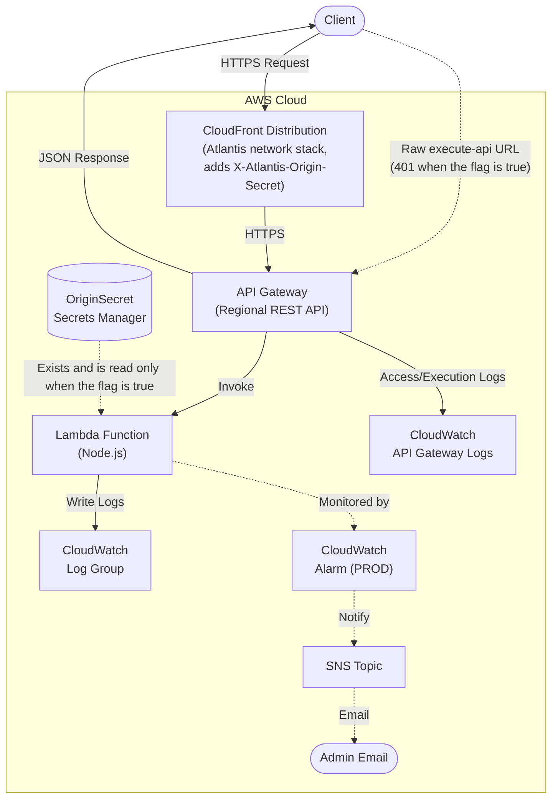
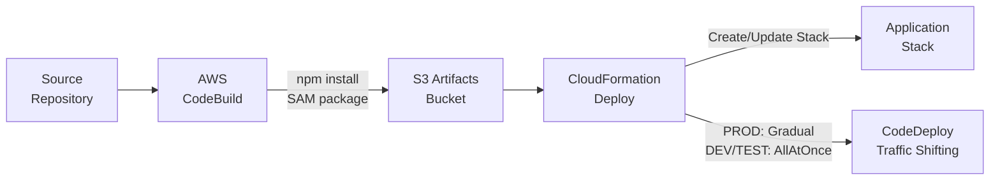

# Architecture

## Directory Structure

```
├── application-infrastructure/    # AWS SAM application stack
│   ├── build-scripts/             # Python scripts used during CodeBuild
│   │   ├── generate-put-ssm.py
│   │   ├── update_template_configuration.py
│   │   └── update_template_timestamp.py
│   ├── src/                       # Lambda source (multi-src layout: one dir per resource)
│   │   └── lambda/
│   │       └── web-service/       # WebService Lambda function (Node.js)
│   │           ├── index.js       # Lambda handler entry point
│   │           ├── utils/
│   │           │   └── ingress-guard.js  # Refuses requests not verified as coming through CloudFront
│   │           └── package.json   # Node.js dependencies
│   ├── buildspec.yml              # AWS CodeBuild build specification
│   ├── template.yml               # AWS SAM/CloudFormation template
│   ├── template-dashboard.yml      # AWS CloudWatch Dashboard (included as module in template.yml)
│   ├── template-openapi-spec.yml   # Open API Spec (included as module in template.yml for API Gateway)
│   └── template-configuration.json # Stack parameters and tags (includes the ApiIsBehindCloudFront flag)
├── docs/                          # Documentation
│   ├── admin-ops/                 # For Admin, Operations
│   ├── developer/                 # For Developer maintaining application
│   └── end-user/                  # For consumer of this application's output (API, Site, Exported reports)
├── scripts/                       # Utility scripts ran by developer (Not part of deployment)
│   └── generate-sidecar-metadata.py
├── AGENTS.md                      # AI and developer guidelines
├── CHANGELOG.md
├── DEPLOYMENT.md
├── ARCHITECTURE.md
└── README.md
```

## Application Stack



## Deployment Pipeline



## Key Design Decisions

- **Gradual deployments** are enabled only in PROD (via CodeDeploy traffic shifting); DEV/TEST deploy all-at-once.
- **CloudWatch Alarms** and SNS notifications are created only in PROD to reduce cost.
- **API Gateway logging** (access + execution) is opt-in and requires an account-level service role to be configured first.
- **Permissions Boundary** support is optional, controlled via a stack parameter.
- **The API is always Regional.** An edge-optimized API is not supported by this starter. With a Regional API, `requestContext.identity.sourceIp` is the viewer address whether a request comes through CloudFront or straight to the API, so the Lambda function runs with `CACHE_DATA_TRUSTED_PROXY_HOPS=0` and reads the client address only through `@63klabs/cache-data`. No application code parses `X-Forwarded-For` or similar headers.
- **Origin protection is opt-in per stage.** The `OriginSecret` secret is created only when `ApiIsBehindCloudFront` is `"true"`, so stages that are not behind CloudFront do not pay for it. In that case the function receives the secret's ARN and read access to that one secret. `@63klabs/cache-data` compares the `X-Atlantis-Origin-Secret` header with the secret, and `utils/ingress-guard.js` turns an unverified request into a `401` with `Cache-Control: no-store` before any routing, validation, or data access. The flag is a literal in `application-infrastructure/template-configuration.json`, changed on the branch being deployed. The secret shows that a request passed through a distribution that holds it; it does not authenticate the caller. See [CloudFront ingress and origin protection](./DEPLOYMENT.md#cloudfront-ingress-and-origin-protection).
- **API Gateway execution data tracing is off** in PROD and whenever the flag is `"true"`, so the origin header is not written to execution logs.
